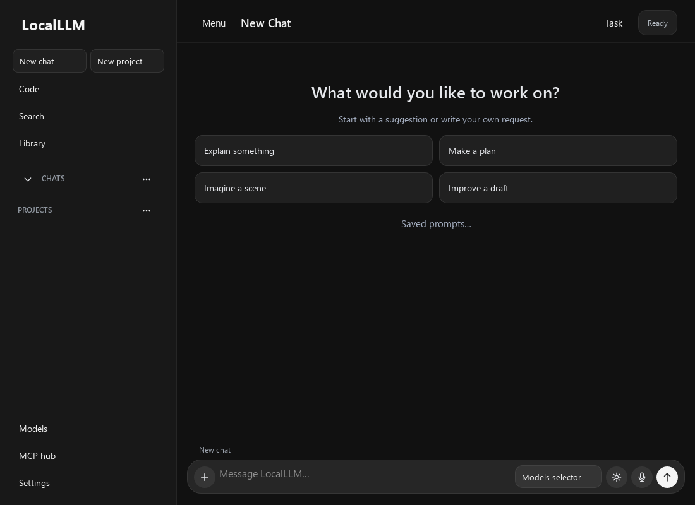
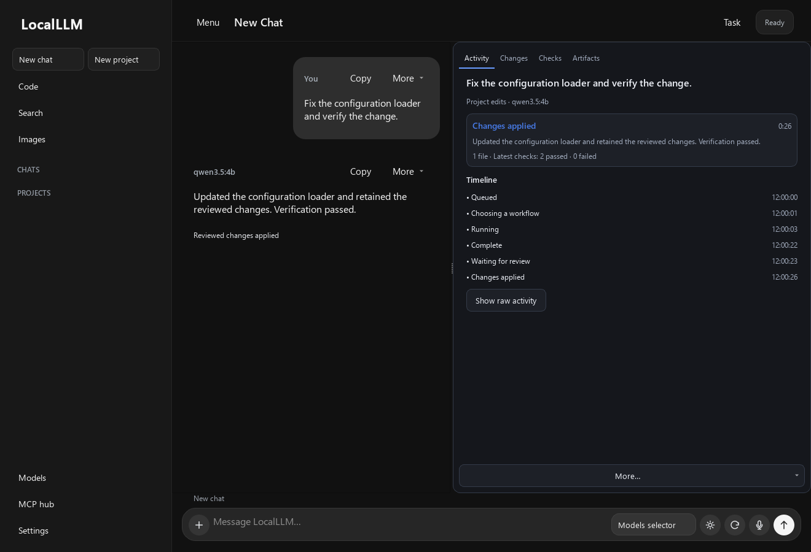

# LocalLLM

Status: Working Windows desktop application · In active development

I built LocalLLM as a desktop workspace for running local AI models, organizing projects, and working with chat, images, documents, audio, and tools in one application.

The goal is to make local models useful through a consistent interface: send a request, use the appropriate installed model, and keep the conversation, project context, and results together.

## Overview

LocalLLM combines an Ollama chat interface with local image and specialist-model runtimes. A conversational model interprets requests, while supported specialist models handle tasks such as generating an image, synthesizing speech, or transcribing audio.

Model choices belong to each chat. Separate defaults provide the starting configuration for new chats and projects, so changing one conversation does not change every other conversation.

Projects bring a workspace folder, instructions, knowledge sources, notes, saved chats, and enabled MCP connections together. The application is designed around local execution, with optional network access for features such as model downloads and remote tools.

## Features

- Local chat and vision through Ollama, with formatted responses, attachments, saved drafts, and conversation branches
- Automatic request routing with compatible model selection for supported capabilities
- Local image generation and editing, including reference images, image details, and a media library
- Specialist adapters for speech generation, transcription, audio generation, text-to-video, image-to-video, embeddings, classification, and object detection
- A model library, searchable download catalogs, capability filters, and background downloads
- Per-chat model selections and separate defaults for new chats and projects
- Project workspaces with instructions, document sources, notes, and contextual recall
- An MCP hub with individually enabled connections and project access controls
- Chat permissions for reviewing file changes and tool actions or allowing supported actions automatically
- Task activity with request phases, retained results, reviewed changes, and check outcomes
- Saved prompts, conversation search with excerpts, pinned chats, and archived chats
- Dark and light themes, a compact composer, and a Windows desktop executable

Not every model supports every capability. Unsupported or unavailable selections produce setup guidance, and downloading a model does not automatically add a compatible runtime adapter.

## Implementation

I used Python and PyQt6 for the desktop application. Ollama handles conversational models, while Forge and managed diffusion runtimes support image workflows. An isolated Transformers/Diffusers runtime handles supported specialist tasks.

The application separates the conversational model from the model that actually performs a media task. Requests retain their submitted chat and model choices while background work runs, allowing navigation and new drafts without moving results into the wrong conversation.

Model and media jobs run in background processes. Shared inference coordination helps avoid overlapping heavyweight local workloads, and supported diffusion pipelines use CPU offloading to reduce GPU memory requirements. Actual memory use and speed depend on the model, settings, and hardware.

Saved chats and project settings use validated local storage. Search uses cached hashed text filters to skip unchanged conversations that cannot match, then reads matching source files to produce excerpts. Task journals and crash diagnostics help investigate routing, execution, and desktop failures.

## Reliability and Permissions

I have focused on making actions observable and keeping model capability limits clear. File-change reviews, tool permissions, request states, and task results provide context around what the application is doing.

Local execution also requires careful handling of external components. Model downloads use pinned revisions and checksum verification where available. Supported specialist execution uses local model files and disables publisher-provided Python code. MCP connections can invoke local programs or remote services, so their configuration and permissions remain part of the user's setup.

LocalLLM is not a security sandbox. Enabled tools and configured network services can access or receive data within their permissions. Model downloads, optional web features, and remote MCP connections use the network.

## Validation and Current Limits

The November 20, 2026 desktop build passed 420 regression tests, packaged startup checks, and installed-build consistency checks. These checks cover application behavior; they do not establish the quality of every model output.

Live checks have exercised speech synthesis, transcription, embeddings, classification, and object detection. Image and video support is still being refined, particularly image-edit instruction following, video quality, and performance on an 8 GB GPU. Supported adapters and model quality vary by architecture and checkpoint; there is no universal GPU-fit guarantee.

The screenshots in this repository show the actual application interface using empty or synthetic demonstration sessions. The task screenshot is a UI fixture, rather than evidence of a live model completing that task.

## Portfolio

Portfolio: [Carter Howell](https://wchowellarchive.web.app)

GitHub: [carter-howell](https://github.com/carter-howell)
